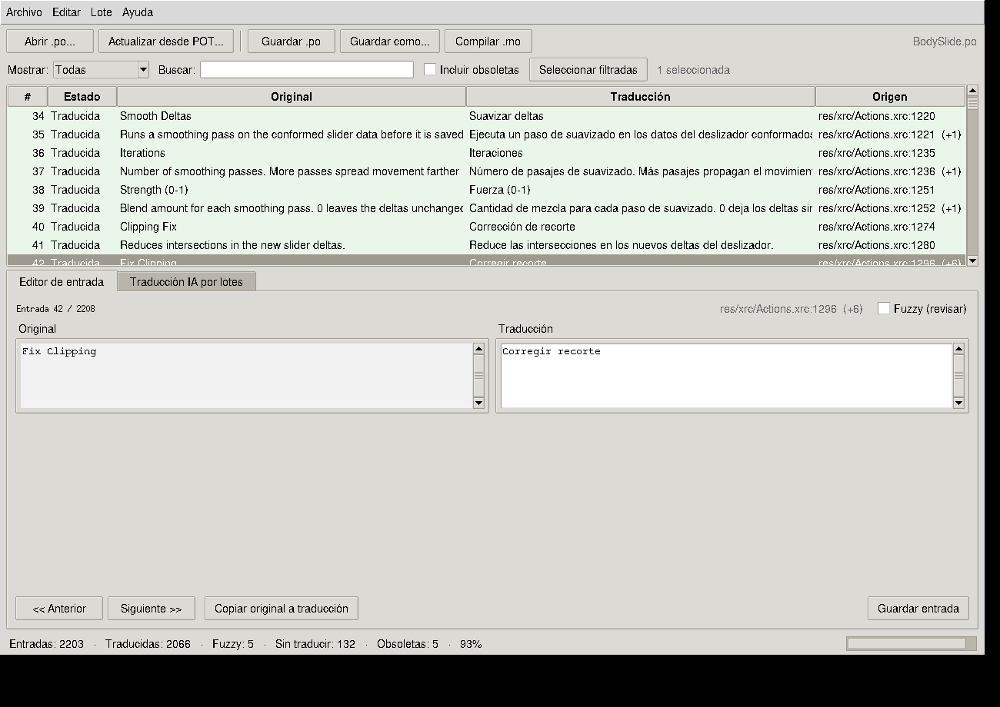
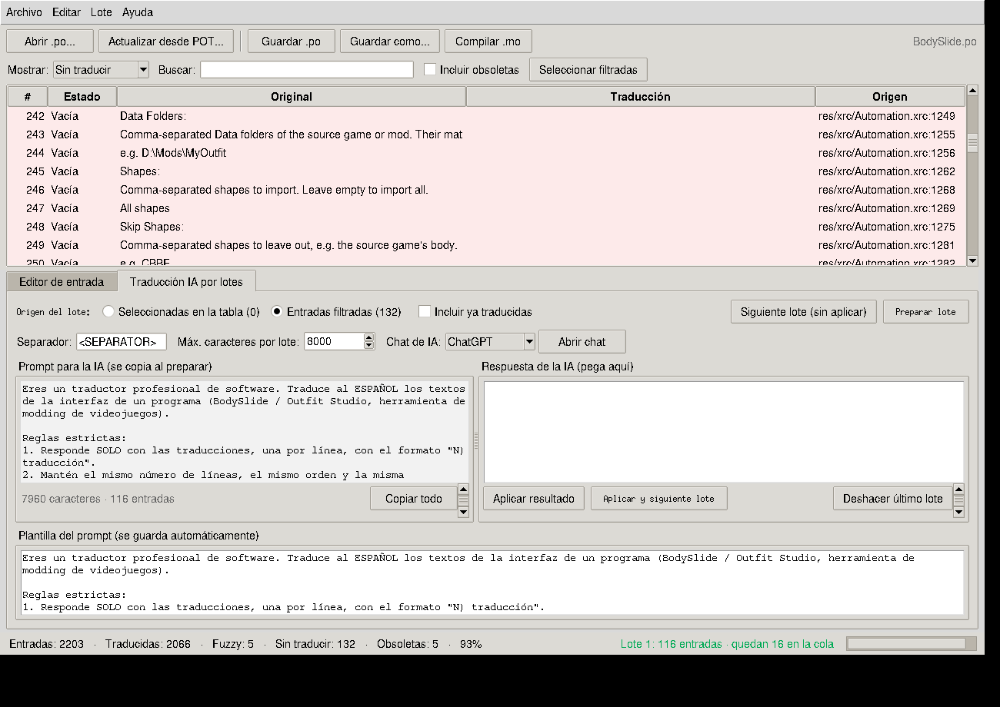
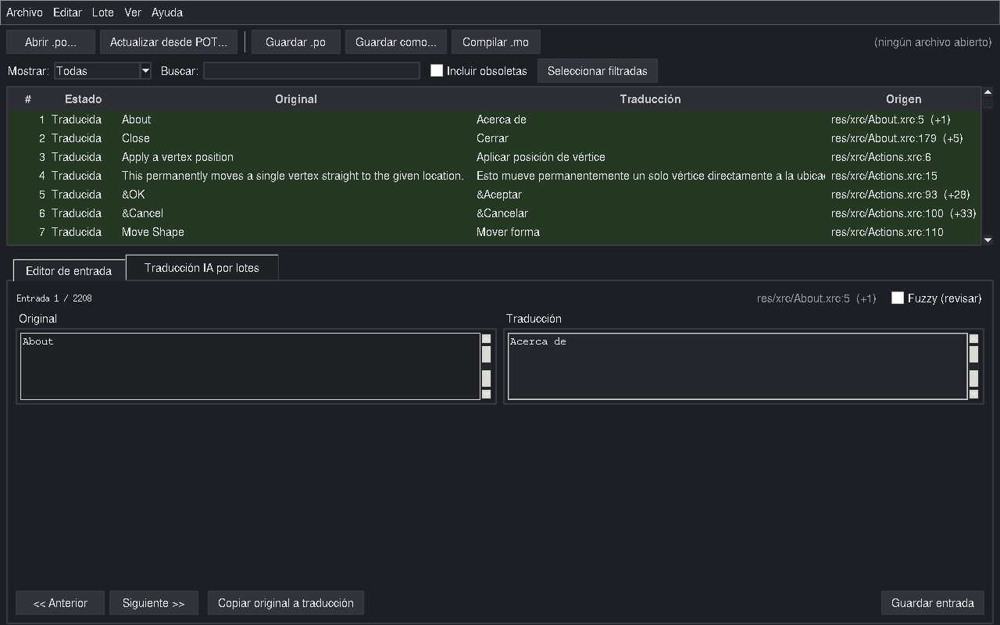

# PoTranslator

**Editor de traducciones gettext (.po / .pot / .mo) con traducción masiva por IA, sin APIs ni claves.**

<p align="center">
  
</p>

Pensado para el flujo de trabajo de *ESP translate*: seleccionas un montón de
cadenas, la app genera un prompt numerado (`1) texto`, una entrada por línea),
lo pegas en el chat de IA que prefieras (ChatGPT, Claude, Gemini, Copilot...),
copias la respuesta de vuelta y PoTranslator reemplaza cada traducción en su
sitio. Cero configuración: solo tu navegador y el portapapeles.

## Características

- **Actualizar un .po desde un .pot nuevo** — fusión al estilo `msgmerge`:
  las traducciones exactas se conservan, los textos que cambiaron quedan
  marcados como *fuzzy* (con el texto anterior visible en `#| msgid`), las
  cadenas nuevas quedan vacías y las eliminadas se guardan como obsoletas
  (`#~`) al final del archivo.
- **Traducción por lotes con cualquier IA** — prompt numerado copiado al
  portapapeles, respuesta pegada y aplicada en un clic, y el lote siguiente
  se prepara solo (con límite de caracteres para que la IA no corte la
  respuesta).
- **Parseo tolerante de la respuesta** — acepta numeración `1)`, `1.`, `1 -`,
  `[1]`, `(1)`, negritas de Markdown (`**1)**`), bloques de código de la IA
  y comillas envolventes. Si la IA no numera, asigna por posición.
- **Protección de marcadores** — `%s`, `%d`, `%lu`, `{{PLACEHOLDER}}`, `\n`
  literales y `&` de atajos de menú se piden intactos en el prompt.
- **Tabla con filtros y multiselección** — Todas / Sin traducir / Con fuzzy /
  Traducidas, color por estado, selección múltiple con Ctrl+clic o Mayús+clic.
- **Editor manual** — edición de entradas con soporte de plurales, "copiar
  original a traducción" para números o términos que no se traducen, y
  acciones en masa con clic derecho.
- **Compilación .mo igual que `msgfmt`** — solo entran las cadenas traducidas
  y revisadas (las *fuzzy* y vacías quedan fuera).
- **Tema oscuro** — se ajusta solo al modo oscuro de Windows y se puede
  cambiar en vivo desde el menú **Ver → Tema** (Automático / Claro / Oscuro).
- **Interfaz en 9 idiomas** — español, inglés, francés, italiano,
  portugués, polaco, ruso, chino y japonés. En el primer arranque la app
  pregunta el idioma (detecta el del sistema); luego se cambia en vivo
  desde **Ver → Idioma**. La plantilla del prompt de traducción también
  viene traducida al idioma elegido.
- **Deshacer por lotes** y copias de seguridad `.bak` automáticas.
- 100 % Python estándar (tkinter) con polib incluida: sin dependencias.

## Descargar (Windows)

1. Entra en la página de [Releases](../../releases).
2. Descarga **`PoTranslator-portable-win64.zip`** (la versión distribuida
   desde la v1.5): descomprime y ejecuta
   `PoTranslator\PoTranslator.exe`.
3. No necesita Python ni instalación.

> La versión de archivo único (`PoTranslator.exe`) se dejó de publicar en
> la v1.5: al ser un ejecutable autoextraíble sin firma digital, varios
> antivirus lo marcaban por error (falso positivo). La portable no tiene
> ese problema. Las versiones antiguas siguen en la página de Releases.

Ajustes portables: en la versión portable la configuración (idioma, tema,
plantilla del prompt…) se guarda en `PoTranslator\_internal\
.potranslator.json`, dentro de la propia carpeta: puedes copiar la
 carpeta a un USB o a otro PC y todo viaja con ella. (Al ejecutar desde
 Python se guarda en `~/.potranslator.json` como siempre.)

El `.exe` se compila automáticamente con GitHub Actions cada vez que se
publica una versión nueva (ver más abajo).

## ⚠️ ¿Tu antivirus marca `PoTranslator.exe` como virus?

Es un **falso positivo**, muy típico en programas Python compilados con
PyInstaller (archivo único, sin firma digital y recién publicados): varios
motores heurísticos los marcan hasta que acumulan reputación. No le pasa solo
a PoTranslator — le pasa a muchísimos proyectos open source.

Lo que marcan esas detecciones («BehavesLike.Win64…», «Gen:Variant.Yogi…»)
es el **cargador autoextraíble** de PyInstaller, no el código de PoTranslator.
Por eso, si tu antivirus se queja del `.exe` suelto, la salida más rápida es
la **versión portable** (`PoTranslator-portable-win64.zip`), que no se
autodescomprime y suele quedar casi limpia.

PoTranslator **no contiene código malicioso**: no hace descargas ni envía
datos, y todo el código fuente está en este repositorio para que cualquiera
lo revise. Si prefieres, compila tu propio `.exe` con `build.bat`.

### Verificar tu copia

Cada Release incluye los archivos `.sha256`, el hash oficial de cada
descarga (`PoTranslator.exe` y `PoTranslator-portable-win64.zip`).
Compáralo en PowerShell:

```powershell
Get-FileHash .\PoTranslator.exe -Algorithm SHA256
```

### Reportar el falso positivo (gratis y ayuda a todos)

- **Bitdefender**: <https://www.bitdefender.com/consumer/support/answer/29358/>
  (o correo a virus_submission@bitdefender.com). *Es el reporte que más
  convierte:* varios motores que usan su tecnología (eScan, VIPRE, Arcabit,
  ALYac…) se limpian a la vez.
- **Bkav**: correo a fpreport@bkav.com
- **ALYac (ESTsecurity)**: correo a esrc@estsecurity.com
- **Arcabit**: correo a support@arcabit.com
- **SecureAge**: <https://www.secureage.com/support/report-false-positive>
- **Arctic Wolf**: correo a virustotal@arcticwolf.com (incluye el enlace de
  VirusTotal y el SHA-256 del archivo)
- **Skyhigh**: portal <https://success.skyhighsecurity.com> (artículo
  «Malware Submission — false positive samples»)
- **Microsoft Defender / SmartScreen**: <https://www.microsoft.com/en-us/wdsi/filesubmission>
- **SentinelOne**: solo acepta reportes de clientes enterprise (portal de
  soporte); las detecciones «Static AI» suelen desaparecer solas cuando el
  archivo acumula descargas limpias.

Si tu antivirus lo detecta, abre un *issue* indicando cuál y qué mensaje
muestra, así llevamos un registro.

> **Nota:** la solución definitiva es firmar el `.exe` con un certificado de
> código (p. ej. el *Open Source Code Signing* de Certum, ~$58/año, o gratis
> para proyectos open source con la
> [SignPath Foundation](https://signpath.org)). Es el plan a futuro.

## Ejecutar con Python (Windows / Linux / macOS)

Requisito: Python 3.8 o superior. En Windows, el instalador de
[python.org](https://www.python.org/downloads/) ya incluye tkinter.

```
python po_translator.py        (o doble clic en "Iniciar PoTranslator.bat")
```

## El flujo de traducción con IA

| Paso | Acción |
|-----:|--------|
| 1 | Abre tu `.po` y actualízalo desde el `.pot` nuevo (**Actualizar desde POT**). |
| 2 | Filtro **"Sin traducir"** y pulsa **Preparar lote**: el prompt ya queda en el portapapeles. |
| 3 | Pega el prompt en tu chat de IA favorito (el botón **Abrir chat** abre ChatGPT, Claude, Gemini...). |
| 4 | Copia la respuesta de la IA y pégala en el panel derecho de la pestaña de lotes. |
| 5 | Pulsa **Aplicar y siguiente lote**: cada línea `N)` reemplaza su entrada y se prepara el siguiente. |
| 6 | Repite hasta vaciar la cola y pulsa **Compilar .mo**. |





Consejos:

- Si la IA corta la respuesta, baja el "Máx. caracteres por lote" (p. ej. a
  6000) y vuelve a preparar el lote.
- Para re-traducir cadenas que cambiaron, usa el filtro **"Con fuzzy"**.
- Si te equivocas en un lote: **Deshacer último lote**.
- Los textos multilínea viajan con `\n` literal y la app los reconvierte sola.

## Compilar el .exe

### Automático con GitHub Actions (recomendado)

El repositorio ya incluye el *workflow* `.github/workflows/build.yml`:

- Cada **push** a `main` compila el `.exe` y la versión portable. Descárgalos
  en la pestaña **Actions** → última ejecución → artefacto `PoTranslator-exe`
  (los artefactos expiran a los 90 días).
- Cada **etiqueta** `v1.3`, `v1.5`... crea además un **Release** permanente
  con la portable en ZIP y su checksum `.sha256` adjuntos, listos para
  compartir:

  ```
  git tag v1.1
  git push --tags
  ```

- También se puede lanzar a mano: **Actions → Compilar EXE → Run workflow**.

Es decir: para actualizar la app solo hay que subir los cambios del código;
el ejecutable se recompila solo en la nube, sin instalar nada.

### Local (Windows)

Doble clic en **`build.bat`**. Requiere Python 3.8+; el script instala
PyInstaller él solo y deja el ejecutable en `dist\PoTranslator.exe`.

Para la versión portable (carpeta):

```
python -m PyInstaller PoTranslator-portable.spec --noconfirm
```

(deja la carpeta en `dist\PoTranslator\`; para compartirla, comprímela
en ZIP).

## Estructura del proyecto

```
po_translator.py              La aplicación (un solo archivo)
polib.py                      Librería gettext (MIT), incluida
Iniciar PoTranslator.bat      Iniciador para Windows (con Python)
build.bat                     Compila PoTranslator.exe (PyInstaller)
PoTranslator.spec             Compilación en archivo único (PyInstaller)
PoTranslator-portable.spec    Compilación portable en carpeta (onedir)
version.txt                   Metadatos del .exe (menos falsos positivos)
icono.ico / icono.png         Icono del ejecutable
capturas/                     Capturas de la app
.github/workflows/build.yml   Compilación automática (GitHub Actions)
LEEME.txt                     Guía rápida incluida en el zip
```

## Créditos

- [polib](https://github.com/izimobil/polib/) de David Jean Louis (licencia MIT),
  incluida como archivo local.
- Creada para mantener la traducción al español de
  [BodySlide and Outfit Studio](https://github.com/ousnius/BodySlide-and-Outfit-Studio).
